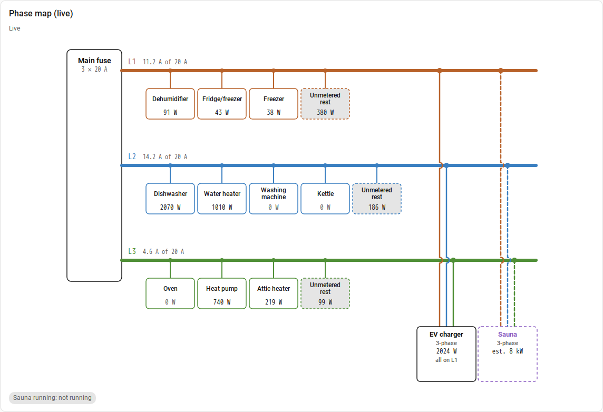

# Phase Map Card

A Home Assistant dashboard card that draws your main fuse as a single-line diagram: one bus
per phase, every load branching off the phase it is connected to, with live or average power.



It needs the **[Phase Map](https://github.com/JanJoh/ha-phase-map)** integration, which
knows which load is on which phase and computes the values.

> [!IMPORTANT]
> The diagram is only as good as your main-fuse readings. Phase Map needs a **reliable,
> frequently updated current or power sensor for every phase at the main fuse** (for example a
> P1/HAN reader with per-phase values or a CT meter on the incoming cables). A house total or
> hourly supplier data is not enough. See
> [Before you start](https://github.com/JanJoh/ha-phase-map#before-you-start-you-need-a-reliable-meter-on-every-phase).

## What it shows

- The **main fuse** on the left, with its rating.
- One **bus per phase** in its own colour, labelled with the current against the fuse rating
  (live) or the average power (average). The label turns red when a phase is close to the fuse.
- **Single-phase loads** hang below their bus with their power, and an **Unmetered rest** box
  (dashed) shows what no meter accounts for.
- **Multi-phase loads** (EV charger, sauna, CEE outlet) on the right: one line per phase in the
  phase's colour, a dot where it joins its own bus, and a small arc where it crosses a bus it
  does not connect to. A charger that only uses one phase says so ("all on L1").
- **Estimated loads** (no meter) are dashed and show their estimate.
- **Unverified phases** are dashed: a conductor to a phase the load has never been seen drawing
  from (a 3-phase charger that has only charged a 1-phase car on L1) is drawn dashed, with an
  open dot where it meets the bus.
- A multi-phase load with **only one meter** says how its power is counted: "1 meter, all on
  L1" or "1 meter, split equally".
- **Meters behind other meters** (a garage's incoming meter with a CEE outlet and a heater
  behind it) get a **sub-panel** below the main diagram, fed from the garage's box: its own
  buses for the phases it measures, its loads on them, and **Other** per phase for what the
  garage meter measures beyond its own meters.
- A load that Phase Map thinks has **moved to another phase** is marked "⚠ L3?".
- **Detectors** from the integration (0.9 or later) are drawn as loads on the phases they
  watch: a dashed box marked *detected* with the estimated power, the reading per phase at the
  junctions, and whether the load is running. What they see is taken out of *Unmetered*. In
  average mode, and with older integrations, they appear as chips under the diagram.

Works in light and dark themes; on narrow screens the diagram scrolls sideways.


## Installation

**You do not need to install the card separately: Phase Map 0.7 and later includes it and
loads it automatically.** This repository is where the card is developed.

For an older Phase Map, or to run a newer card than the one included, install it manually:

1. Copy `dist/phase-bus-card.js` to `config/www/phase-bus-card.js`.
2. **Settings → Dashboards → ⋮ → Resources → Add resource**: URL
   `/local/phase-bus-card.js`, type **JavaScript module**.
3. Reload the browser.

Once public, it will be installable through HACS as a custom repository (category: Dashboard).

## Configuration

Add it from the card picker (**Phase Bus Card**), or in YAML:

```yaml
type: custom:phase-bus-card
title: Phase map
mode: live          # live (default) or average
days: 10            # average over this many days (mode: average)
entry_id: …         # optional: which main fuse, if you have more than one
colors:             # optional: phase colours
  L1: "#b8622a"
  L2: "#3a7fc1"
  L3: "#4f8f36"
```

| Option | Default | Meaning |
|---|---|---|
| `title` | none | Card heading |
| `mode` | `live` | `live` shows current values; `average` shows average power from long-term statistics |
| `days` | `10` | Averaging window for `mode: average` (1–90) |
| `entry_id` | first entry | The Phase Map config entry to draw |
| `colors` | brown / blue / green | Colour per phase name (also in the visual editor, under *Phase colours*) |

Load names wrap over two lines automatically; put a `|` in a load's name in Phase Map to
choose the break yourself (for example `Heat pump|compressor`).

## Development

The card is one file without a build step. Tests run with Node 22: `node --test test/*.test.js`.
After a change, copy it into the integration with `scripts/sync_card.sh` in the ha-phase-map
repository.

## Known issues

See [the card's issue tracker](https://github.com/JanJoh/ha-phase-map-card/issues) for known
issues and to report a problem. For anything about the values themselves (phases, unmetered
current, detectors), use the [integration's issue tracker](https://github.com/JanJoh/ha-phase-map/issues).

## License

[MIT](LICENSE)
